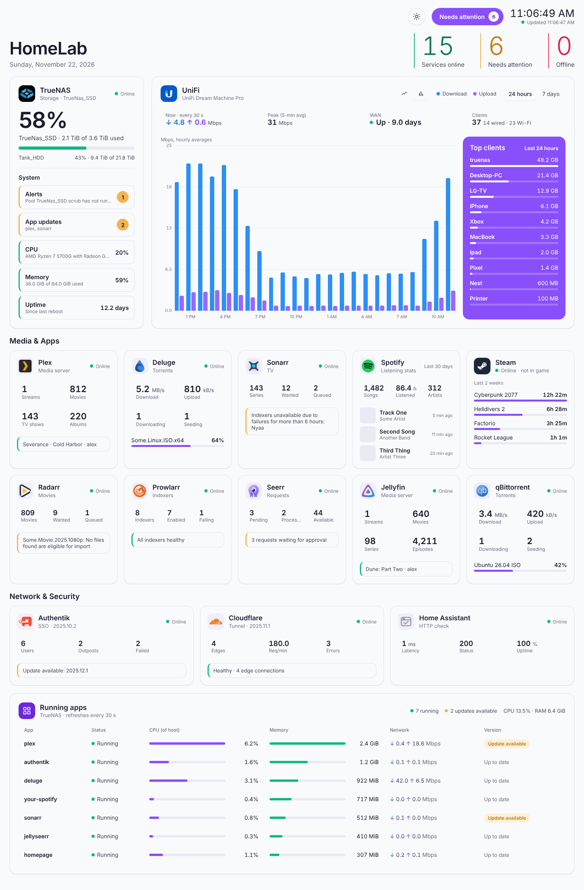
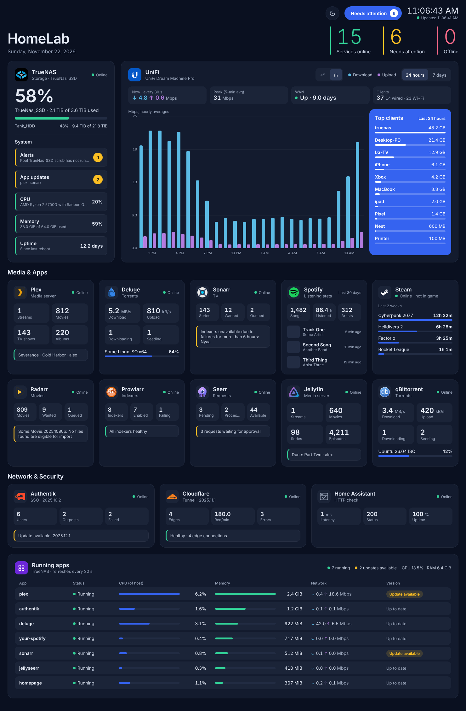
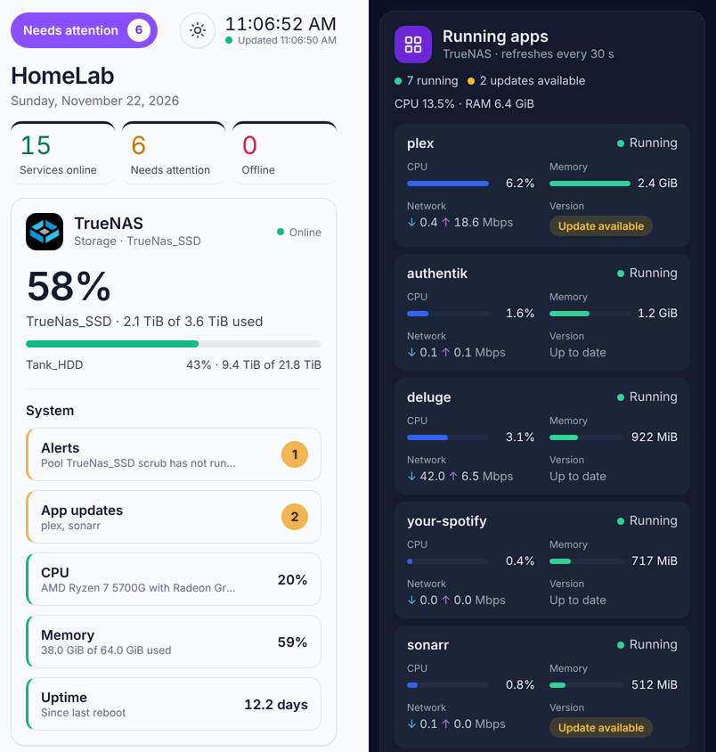

# HomeLab dashboard

A single-page homelab dashboard for TrueNAS SCALE.

- **Backend:** a Python standard-library server polls each service, caches the last good result and serves the page on port 3000. There are no pip dependencies; it runs on the stock `python:3.13-slim` image.
- **Themes:** light and dark, with a toggle in the top bar.
- **Phones:** the layout adapts. Tiles stack into one column and the Running apps table turns into cards.

## Screenshots

The screenshots below use sample data.

| Light | Dark |
|---|---|
|  |  |

**On a phone:** the left screenshot is the light theme; the right one shows Running apps as cards, in the dark theme.



## Layout of the page

| Area | Source | Configured in |
|---|---|---|
| Header KPIs + Needs attention | Rolled up from every tile | – |
| TrueNAS (pool, alerts, app updates, CPU, memory, uptime) | TrueNAS JSON-RPC over `wss://…/api/current`, Glances | `compose.yaml` |
| UniFi (rates, peak, WAN, clients, throughput chart, top clients) | UniFi Network API (`X-API-KEY`) | `compose.yaml` |
| **Tile sections** (Media & Apps, Network & Security, …) | One integration per tile | `dash/services.toml` |
| Running apps (CPU, memory, network, updates) | TrueNAS `app.query` + Docker stats via docker-socket-proxy | `compose.yaml` |

## Files

```
compose.yaml                  TrueNAS custom app (Install via YAML): dockerproxy, glances, dash
dash/app.py                   server: TrueNAS, UniFi, Docker pollers, state, HTTP
dash/tiles.py                 tile types (one function each)
dash/services.example.toml    every tile type with its options - copy to services.toml
dash/static/                  front end: index.html, style.css, app.js, icons/
your-spotify/                 entrypoint patch to make Your Spotify poll Spotify every 30 s
```

## Deploy

1. Copy `dash/` to `/mnt/TrueNas_SSD/homepage/dash`, then create `/mnt/TrueNas_SSD/homepage/helper-data`. Give the `apps` user (568) Modify on both, with inherit enabled.
2. Copy `dash/services.example.toml` to `dash/services.toml`. Keep the tiles you want and fill in the URLs.
3. In TrueNAS, go to **Apps > Discover > Install via YAML** and paste `compose.yaml`. Then replace every `REPLACE_ME`, and add one environment variable for each `${NAME}` used in `services.toml`.
4. Open `http://<nas>:3000`.

To update, copy the changed files into `/mnt/TrueNas_SSD/homepage/dash`:
- A change to `static/` only needs a hard refresh (Ctrl+F5).
- A change to `app.py`, `tiles.py` or `services.toml` needs the app restarted.

## Tiles (`services.toml`)

Each `[[tile]]` block is one tile. Tiles appear in file order, grouped under their `section`.

```toml
[[tile]]
type = "radarr"
url = "http://10.0.0.5:7878"
key = "${RADARR_KEY}"          # RADARR_KEY is set in the compose environment
section = "Media & Apps"       # optional, this is the default
```

| Type | Shows | Needs |
|---|---|---|
| `plex` | streams, library counts, what's playing | `url`, `token` |
| `jellyfin` | streams, movies, series, episodes, what's playing | `url`, `key` |
| `deluge` | speeds, downloading/seeding, active downloads | `url`, `password` |
| `qbittorrent` | speeds, downloading/seeding, active downloads | `url`, optional `username`/`password` |
| `sonarr`, `radarr`, `lidarr` | library size, wanted, queue, health warnings, stuck downloads | `url`, `key` |
| `prowlarr` | indexers, enabled, failing, health warnings | `url`, `key` |
| `seerr` / `jellyseerr` / `overseerr` | pending, processing, available requests | `url`, `key` |
| `your_spotify` | songs, hours, artists (30 days), last 3 tracks | `url` (ends in `/api`), `token` |
| `steam` | online status, games from the last 2 weeks | `key`, `steam_id` |
| `authentik` | users, outposts, failed logins (24 h), update available | `url`, `token` (admin API token) |
| `cloudflared` | edge connections, requests/min, errors, version | `url` of the metrics server |
| `http` | up/down, latency, status code, uptime | `url` |
| `json` | any numbers from any JSON API, picked by path | `url`, `stats` |

**Options every tile accepts:** `name`, `subtitle`, `section`, `icon`, `link`, `poll` (seconds) and `enabled = false`.

**Icons:**
- With no `icon` setting, a tile uses `static/icons/<type>.svg` (or `.png`). If that file doesn't exist, it uses the [dashboard-icons](https://github.com/homarr-labs/dashboard-icons) CDN.
- `icon = "home-assistant"` picks any icon from that set by name.
- `icon = "my.png"` uses a file in `static/icons/`.
- A full URL works too.

**Warnings feed the header:** health warnings, stuck downloads, failed logins and available updates from tiles appear under "Needs attention".

**Setup notes:**
- **Authentik:** create the token under Admin > Directory > Tokens & App passwords, with intent "API", for an admin user. The version check and the failed-login count need admin rights.
- **cloudflared:** the metrics server listens on localhost by default. Set `TUNNEL_METRICS=0.0.0.0:2000` on the cloudflared container and publish that port.
- **`json` example (Pi-hole, AdGuard and the like):**
  ```toml
  stats = [ { label = "Queries", path = "num_dns_queries" },
            { label = "Blocked", path = "queries.percent", format = "percent" } ]
  ```
  `format` can be `number` (the default), `bytes`, `percent` or `text`. A path can index into lists, e.g. `data[0].count`.

Without a `services.toml`, the app falls back to the old `PLEX_URL` / `DELUGE_URL` / `SONARR_URL` / `YOURSPOTIFY_URL` / `STEAM_*` variables.

## Adding a tile type

Add a function to `dash/tiles.py`:

```python
@tile("uptime_kuma", "Uptime Kuma", "Monitoring", needs=("url", "key"))
def uptime_kuma(t):
    data = get_json(f"{t.url}/api/...", headers={"Authorization": f"Bearer {t.get('key')}"})
    return {
        "stats": [stat(data["up"], "Up"), stat(data["down"], "Down")],
        "lines": [{"text": "All monitors up", "level": "ok"}],
        "alerts": [],          # {"level": "warning", "title": ..., "text": ...} feed Needs attention
    }
```

The function returns plain data, and the page draws it. You can return:
- `stats`, `lines`, `bars`, `list` and `note` for the tile body.
- `sub` to replace the subtitle, and `right` to replace the status pill.
- `alerts` to feed Needs attention.

The top of `tiles.py` documents each one. Use `t.cached("name", seconds, fn)` for anything expensive, such as library counts. Raise an exception to show the tile as unreachable; the last good data stays on screen.

## Configuration notes

- Commit **no real keys**. Keep them in the TrueNAS app config, and reference them from `services.toml` as `${NAME}`.
- `STEAM_ID` must be quoted in the compose file. Unquoted, YAML rounds it.
- Use the TrueNAS API key only over wss/https. TrueNAS revokes a key that is used over plain HTTP.
- URL overrides:
  - `?chart=line` and `?range=168` force the chart style and range.
  - `?theme=light` and `?theme=dark` force the theme.
  - Choices made in the UI are saved per browser.

Optional environment variables, with their defaults:
- `POLL_SECONDS=30`, `SLOW_POLL_SECONDS=300`
- `RETENTION_DAYS=7`, `TOP_N=10`
- `PRIMARY_POOL` (default: largest pool)
- `UNIFI_SITE=default`, `UNIFI_NAME`
- `SERVICES_FILE=/app/services.toml`
- `DB_PATH=/data/helper.db`, `PORT=3000`

Icons for added integrations come from [homarr-labs/dashboard-icons](https://github.com/homarr-labs/dashboard-icons) (Apache-2.0).
